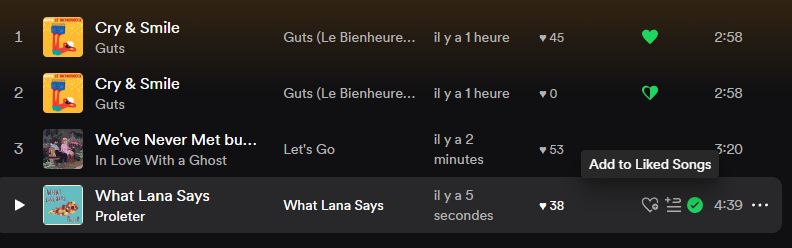

# Old Like Button Revamped

_Adds the old "like" button back next to the new "Add to Playlist" button on tracklist rows, including a half-heart indicator when you like a different version (remaster, live version, etc.) of the same recording._

Fork of [Maskowh/spicetify-old-like-button-extension](https://github.com/Maskowh/spicetify-old-like-button-extension), which broke after Spotify changed the APIs it depended on and appears abandoned. This fork fixes it: liked status, add/remove, the half-liked indicator, tooltip styling, and a playbar button that could vanish on song change are all working again. Commit history has the detail on each fix.

## Installation

### Manual

1. Install [Spicetify](https://spicetify.app).
2. Run `spicetify config-dir` to find your config folder, then place `oldLikeButton.js` in its `Extensions` subfolder.
3. Run `spicetify config extensions oldLikeButton.js` then `spicetify apply`.

### Marketplace

Search "Old Like Button Revamped" in the Extensions tab of Marketplace and install it. Marketplace discovers extensions automatically from public repos tagged `spicetify-extensions` on GitHub.

## Usage

- **Full heart**: this track is in your Liked Songs.
- **Half heart**: you don't have this exact track liked, but you do have a different version of the same recording liked (same ISRC, e.g. a remaster).
- **No heart**: neither.

Hover a tracklist row to see the button; click to add or remove from Liked Songs.

## Credits

Original extension by [Maskowh](https://github.com/Maskowh), with the rendering approach based on [ohitstom](https://github.com/ohitstom)'s [Quick Queue extension](https://github.com/ohitstom/spicetify-extensions/blob/main/quickQueue/README.md).
